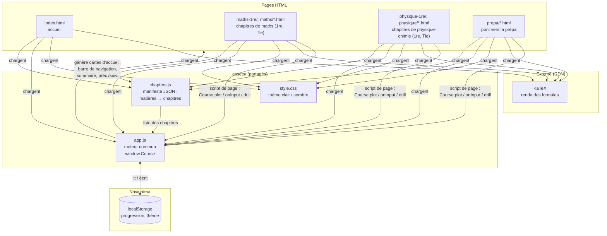
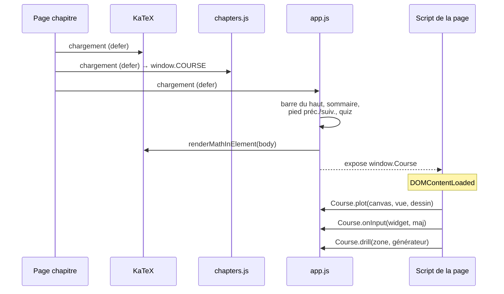

# Remise à niveau — Terminale STI2D → Prépa

Cours interactif en français (maths + physique-chimie) pour consolider tout le programme de
**Première et Terminale STI2D** (tronc commun de maths, spécialité « physique-chimie et
mathématiques ») et arriver en **classe préparatoire** (TSI, PTSI…) sans lacune.

| Niveau | Matière | Dossier | Chapitres |
|---|---|---|---|
| Première | Mathématiques | `maths-1re/` | 14 |
| Première | Physique-chimie | `physique-1re/` | 14 |
| Terminale | Mathématiques | `maths/` | 11 |
| Terminale | Physique-chimie | `physique/` | 7 |
| Vers la prépa | Méthodes | `prepa/` | 4 |

Chaque chapitre contient : cours, exemples rédigés, animations manipulables, exercices
auto-générés, quiz corrigé et liens vers des vidéos en français.

## Utilisation

Ouvrir `index.html` dans un navigateur (double-clic suffit), ou servir le dossier :

```bash
python3 -m http.server 8000   # puis http://localhost:8000
```

Les formules sont rendues avec [KaTeX](https://katex.org) (chargé depuis un CDN : il faut une
connexion internet pour un affichage propre des formules). La progression est enregistrée dans le
navigateur (localStorage).

## Architecture

Site **100 % statique** (HTML + CSS + JavaScript sans framework ni étape de build) : il s'ouvre
directement depuis le disque et se publie tel quel sur GitHub Pages.



### Cycle de vie d'une page de chapitre



### Anatomie d'un chapitre


### API `Course` (assets/app.js)

| Fonction | Rôle |
|---|---|
| `Course.plot(canvas, vue, dessin)` | repère (grille, axes, graduations, π) + primitives `fn`, `param`, `point`, `seg`, `arrow`, `area`, `poly`, `circle`, `text` ; redessin automatique (redimensionnement, thème) |
| `Course.onInput(racine, maj)` | lit tous les champs `[data-k]` d'un widget, met à jour les `<output data-show>` et appelle `maj(valeurs)` |
| `Course.drill(racine, générateur)` | exercice infini : le générateur renvoie `{q ou html, answer, tol, explain}` ; saisie tolérante (`3/4`, `2,5`, `ln(2)`, `pi`) |
| `Course.fmt`, `parseNum`, `tex`, `renderMath`, `rand`, `pick`, `el`, `color`, `icon` | utilitaires |

Automatique, sans rien écrire dans les pages :

- **Plein écran** : chaque `.widget` qui contient un `<canvas>` reçoit un bouton plein écran
  (graphique + réglages ; côte à côte en paysage, empilés en portrait ; Échap pour sortir).
- **Brouillon + calculatrice** (`assets/brouillon.js`) : chaque exercice `Course.drill` reçoit, à
  côté de « Vérifier », un bouton calculatrice qui ouvre une feuille noire plein écran (saisie
  clavier ou stylo), une palette de symboles (fractions, puissances, √, ln, log, ∫, Σ, lim, ≤, ∈…)
  et une calculatrice scientifique (degrés/radians, Ans, historique) dont le résultat peut être
  envoyé dans la feuille ou utilisé comme réponse. La feuille est conservée par chapitre.
- **Mobile** : menu des matières repliable, sommaire repliable, formules larges découpées ou
  défilantes, tableaux défilants, cibles tactiles de 44 px, zones sûres de l'encoche.

`assets/core.js` regroupe les fonctions pures (sans DOM), testées unitairement : évaluateur
d'expressions sûr (`evaluate`, sans `eval`), `parseNum`, `fmt`, `fmtCalc`, graduations
(`tickStep`, `decimalsFor`), `insertSnippet`, `splitTopLevel`.

## Structure

```
index.html            accueil (chapitres regroupés par niveau, générés depuis le manifeste)
assets/chapters.js    manifeste : matières et chapitres (JSON entre marqueurs)
assets/core.js        fonctions pures testées : évaluateur, formatage, graduations
assets/app.js         moteur commun : navigation, quiz, traceur de courbes, exercices, plein écran
assets/brouillon.js   brouillon plein écran + palette de symboles + calculatrice
assets/style.css      styles communs (thème clair/sombre)
maths-1re/ physique-1re/  Première : un fichier HTML par chapitre
maths/ physique/ prepa/   Terminale et pont vers la prépa
templates/chapitre.html   modèle pour écrire un nouveau chapitre
tests/                tests de cohérence (Python), tests/js/ (unitaires, node --test),
                      tests/e2e/ (navigateur : ordinateur, Android, iPhone, iPad)
```

## Ajouter un chapitre

1. Copier `templates/chapitre.html` vers `<matière>/<slug>.html`.
2. Ajouter l'entrée `{ "slug", "title", "summary", "tags" }` dans `assets/chapters.js`
   (chaque matière porte un `level` : `1re`, `tle` ou `prepa`, décrit dans `levels`).
3. Lancer les tests.

## Tests

```bash
python3 -m unittest discover -s tests -v   # structure + tests unitaires JS (si node est installé)
npm ci && npx playwright install chromium   # une fois
npm run test:e2e                            # navigateur : ordinateur, Android, iPhone, iPad
```

Les tests de bout en bout vérifient sur chaque appareil émulé : aucune page ne déborde
horizontalement, menu mobile, plein écran des graphiques, brouillon, calculatrice, stylo.

Ils vérifient : manifeste ↔ fichiers, HTML bien formé, liens locaux, ancres, délimiteurs de
formules équilibrés, structure de chaque chapitre (définitions, ≥ 2 exemples, ≥ 1 widget,
quiz ≥ 4 questions avec réponse valide et explication, ≥ 2 liens vidéo), utilisation de l'API
`Course` existante, et syntaxe JavaScript (si `node` est installé). Ils tournent aussi en CI
(GitHub Actions) sur chaque pull request.

## Sources

Le contenu est original et suit les programmes officiels publiés au Bulletin officiel (voir
eduscol.education.fr) : programme de mathématiques de la classe de première technologique
(enseignement commun) et programme de spécialité « physique-chimie et mathématiques » de
première STI2D (BO spécial n° 1 du 22 janvier 2019), puis ceux de Terminale. Ce sont les mêmes
programmes que suivent les manuels utilisés en classe (*Algomaths 1re et Tle séries techno*,
Delagrave ; *Physique-Chimie 1re STI2D*, Delagrave ; *Physique-Chimie Tle STI2D*, Nathan).
Aucun contenu de ces manuels n'est reproduit. Les liens vidéo pointent vers des recherches YouTube
(chaînes pédagogiques françaises : Yvan Monka, etc.) pour rester valides dans le temps.
