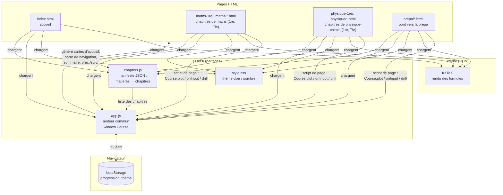
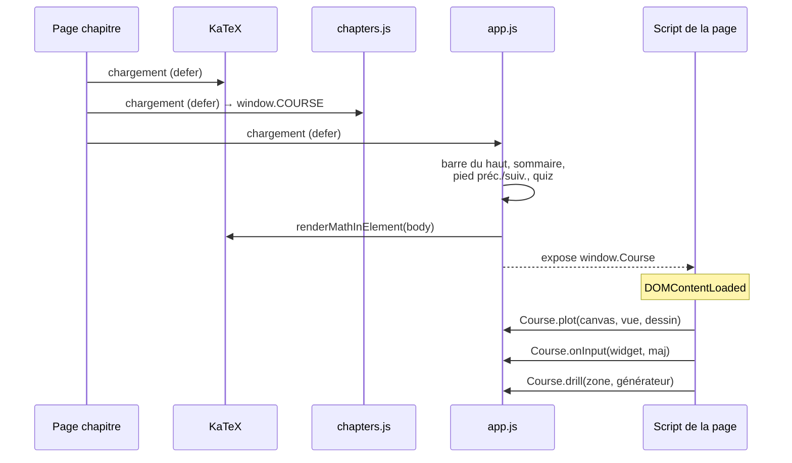

# Remise à niveau — Terminale STI2D → Prépa

Cours interactif en français (maths + physique-chimie) pour consolider tout le programme de
**Première et Terminale STI2D** (tronc commun de maths, spécialité « physique-chimie et
mathématiques ») et arriver en **classe préparatoire** (TSI, PTSI…) sans lacune.

| Niveau | Matière | Dossier | Chapitres |
|---|---|---|---|
| Première | Mathématiques | `maths-1re/` | 14 |
| Première | Physique-chimie | `physique-1re/` | 14 |
| Terminale | Mathématiques | `maths/` | 11 |
| Terminale | Physique-chimie | `physique/` | 7 |
| Vers la prépa | Méthodes | `prepa/` | 4 |

Chaque chapitre contient : cours, exemples rédigés, animations manipulables, exercices
auto-générés, quiz corrigé et liens vers des vidéos en français.

## Refonte en cours : feuille de route et règles

Cette section fait foi pour la refonte. Toute nouvelle version de chapitre la respecte.

### Feuille de route : Physique-chimie 1re STI2D (15 chapitres)

Chaque chapitre est réécrit et amélioré à partir des PDF de cours et d'exercices fournis.

- [x] 1. L'énergie et ses enjeux (PDF de cours et d'exercices fournis)
- [x] 2. Énergie interne (PDF de cours et d'exercices fournis)
- [x] 3. Énergie chimique (PDF de cours et d'exercices fournis)
- [ ] 4. Équation de réaction et molécules (PDF de cours et d'exercices fournis)
- [ ] 5. Électricité régime continu
- [ ] 6. Électricité régime variable
- [ ] 7. Puissance électrique
- [ ] 8. Solution aqueuse
- [ ] 9. Oxydoréduction et piles
- [ ] 10. Notion d'onde
- [ ] 11. Ondes sonores
- [ ] 12. Ondes électromagnétiques
- [ ] 13. Cinématique
- [ ] 14. Forces
- [ ] 15. Travaux des forces et énergie mécanique

### Méthode de travail

- Les chapitres se font **un par un**. On ne passe pas au suivant tant que le précédent n'a pas
  été testé et confirmé.
- Une case de la feuille de route ci-dessus est cochée seulement après cette validation.
- Chaque chapitre passe par une pull request, relue sur le site affiché, avant toute fusion.

### Direction visuelle, mise en page et interactivité

- **Esthétique générale (style Linear / Raycast)** : refonte complète vers un mode sombre
  d'outil d'ingénieur, sobre et soigné. Fond anthracite profond `#0B0D12` (pas un noir plat),
  bordures nettes de `1px` semi-transparentes, halos radiaux discrets, typographie géométrique
  et nette, beaucoup d'espace. Les styles partagés restent dans `assets/style.css` et
  `assets/core.js`.
- **Grille « bento » aérée à 2 colonnes** (pas une longue pile verticale monotone) :
  - Conteneur principal élargi sur ordinateur (`max-width` de `1200px` à `1280px`). Les cartes
    de cours et d'exemples sont rangées dans une **grille CSS responsive à 2 colonnes**
    (`1 | 2` sur la première ligne, `3 | 4` sur la deuxième…) avec des espacements généreux
    (`24px`). La page reste aérée, facile à parcourir, et on ne s'y perd pas.
  - L'ordre de lecture reste clair (en-têtes ou pastilles numérotés sur les cartes). Seuls les
    éléments larges prennent toute la largeur (`grid-column: 1 / -1`) : grands tableaux de
    données, graphiques de *Manipuler*, écrans partagés d'*Entraînement* et d'*Évaluation*.
  - Passage propre à 1 colonne sur mobile et petits écrans.
- **Codes couleur et cartes** : on garde le code couleur sémantique existant (cyan pour les
  actions principales et notions clés, violet pour les définitions et formules, ambre/orange
  pour les exemples, vert pour les méthodes et protocoles). Bordure gauche colorée + fond
  légèrement teinté (3 à 5 % d'opacité), en-têtes en pastille, boutons `Solution` cliquables
  sur toute la largeur. Les couleurs citées dans le texte et les légendes sont **exactement**
  celles des graphiques.
- **Interactivité et ludification (style Duolingo)** : l'entraînement et la progression doivent
  être tactiles, gratifiants et motivants : boutons qui s'enfoncent avec un léger relief,
  compteur de série visible, barres de progression claires, micro-animations et retours fluides
  sur les bonnes et les mauvaises réponses.

### Structure obligatoire en 6 étapes

Elle s'applique à **tous** les chapitres, toutes matières et tous niveaux (maths et physique,
1re et Terminale), dans cet ordre exact :

1. **Cours** : explication complète et bien structurée de chaque notion, avec toutes les
   formules associées (dans la grille bento à 2 colonnes quand c'est pertinent). Même
   vocabulaire technique, mêmes définitions et mêmes notations que les PDF de cours fournis.
   Formules, variables, exposants et unités rendus proprement avec KaTeX.
2. **Exemples concrets** : exemples résolus pas à pas (inspirés des PDF d'exercices) pour
   comprendre comment les notions et les formules s'utilisent en pratique.
3. **Manipuler** : graphiques interactifs dont les variables sont **toujours** liées
   directement aux formules du cours (par exemple l'énergie en fonction du temps, dont la pente
   est la puissance).
   - Axes nommés avec unités et mini-légende claire.
   - Cartes d'indicateurs (KPI) réactives plutôt que des blocs de texte en police
     monospace (avec pastilles de statut colorées quand c'est utile).
   - 2 ou 3 boutons de préréglages pédagogiques sous les curseurs.
   - Même code couleur entre formules, curseurs et graphiques.
4. **Entraînement** : exercices paramétrés inspirés des PDF d'exercices (valeurs aléatoires
   propres, consigne adaptée au type exact de question, retour pédagogique sur les erreurs
   fréquentes avant d'afficher la solution complète).
   - **Espace de travail partagé (`Brouillon / Calc`)** : la feuille noire de brouillon et une
     calculatrice compacte côte à côte, en écran partagé.
   - **Aiguillage des symboles** : un petit sélecteur choisit où s'insèrent les symboles
     mathématiques : `{ Utiliser les symboles sur la feuille / calculatrice }`.
   - **Calculatrice d'entraînement** : les symboles avancés (intégrales définies $\int_a^b$,
     dérivées, primitives) peuvent être calculés directement par la calculatrice (si l'élève
     le choisit). Sur la feuille noire, ils restent une simple écriture, jamais évaluée.
5. **Évaluation (sur 20 points)** :
   - **Déblocage** : verrouillée tant que l'élève n'a pas obtenu une **série d'au moins 5 bonnes
     réponses consécutives** en *Entraînement* (progression enregistrée dans `localStorage`).
   - **Espace de travail en mode examen** : écran partagé brouillon + calculatrice, mais la
     calculatrice est en **mode examen** : seules les fonctions d'une calculatrice standard
     marchent (pas de calcul automatique de dérivées, primitives ou intégrales : l'élève les
     calcule à la main, contrairement à l'*Entraînement*).
6. **Validation et progression** :
   - **Note ≥ 15/20** : le chapitre est validé, l'élève peut passer au chapitre suivant.
   - **Note < 15/20** : le chapitre n'est pas validé. L'évaluation se reverrouille, et l'élève
     doit revenir à l'*Entraînement* et refaire une **nouvelle série de 5** pour retenter.

### Contrôle qualité en fin de chapitre

- Tests Playwright : zéro erreur dans la console, affichage propre sur ordinateur et mobile.
- `/impeccable critique` puis `/impeccable polish` si besoin, avant de demander la relecture.

## Utilisation

Ouvrir `index.html` dans un navigateur (double-clic suffit), ou servir le dossier :

```bash
python3 -m http.server 8000   # puis http://localhost:8000
```

Les formules sont rendues avec [KaTeX](https://katex.org) (chargé depuis un CDN : il faut une
connexion internet pour un affichage propre des formules). La progression est enregistrée dans le
navigateur (localStorage).

## Architecture

Site **100 % statique** (HTML + CSS + JavaScript sans framework ni étape de build) : il s'ouvre
directement depuis le disque et se publie tel quel sur GitHub Pages.



### Cycle de vie d'une page de chapitre



### Anatomie d'un chapitre

> Les chapitres refondus suivent la structure en 6 étapes décrite plus haut (`main.chapter.v2`,
> sections `#cours`, `#exemples`, `#manipuler`, `#entrainement`, `#evaluation`, `#validation`).
> Le schéma ci-dessous décrit les chapitres pas encore refondus.


### API `Course` (assets/app.js)

| Fonction | Rôle |
|---|---|
| `Course.plot(canvas, vue, dessin)` | repère (grille, axes, graduations, π) + primitives `fn`, `param`, `point`, `seg`, `arrow`, `area`, `poly`, `circle`, `text` ; redessin automatique (redimensionnement, thème) |
| `Course.onInput(racine, maj)` | lit tous les champs `[data-k]` d'un widget, met à jour les `<output data-show>` et appelle `maj(valeurs)` |
| `Course.drill(racine, générateur)` | exercice infini : le générateur renvoie `{q ou html, answer, tol, explain}` ; saisie tolérante (`3/4`, `2,5`, `ln(2)`, `pi`) |
| `Course.trainer(racine, générateur, { workspace })` | entraînement des chapitres en 6 étapes : série de bonnes réponses du premier coup, jauge « série de 5 », QCM ou saisie avec unité, erreurs fréquentes (`traps`) expliquées avant la solution |
| `Course.exam(racine, { build, workspace, trainWorkspace })` | évaluation sur 20, verrouillée jusqu'à la série de 5, calculatrice en mode examen, correction détaillée ; < 15/20 la reverrouille |
| `Course.validation(racine)` | état du chapitre (validé ou non) et passage au chapitre suivant |
| `Course.presets(hôte, liste)`, `Course.kpis(hôte, définitions)` | préréglages des curseurs et cartes d'indicateurs réactives des widgets « Manipuler » |
| `Course.progress()`, `setProgress`, `onProgress` | progression du chapitre (`localStorage`, clé `progress:<chapitre>`) |
| `Course.fmt`, `parseNum`, `tex`, `renderMath`, `rand`, `pick`, `el`, `color`, `icon`, `esc` | utilitaires |

Formules en couleur : les macros KaTeX `\QE`, `\QEr`, `\QEu`, `\QEp`, `\QP`, `\Qt`, `\Qeta` (chapitre 1),
`\QU`, `\QQ`, `\QT`, `\QdT`, `\QTi`, `\QTf`, `\QTeq`, `\Qm`, `\Qc`, `\QL` (chapitre 2), `\QPC`, `\Qdm`, `\Qrho`, `\Qd`,
`\QV` (chapitre 3), `\Qn`, `\QM`, `\QVm` (chapitre 4) et `\q{classe}{…}`
donnent à chaque grandeur la couleur `--q-*` utilisée par ses curseurs, ses cartes et ses courbes. Deux grandeurs
qui partagent un graphique ont toujours des teintes validées ensemble (daltonisme et vision normale) ; la masse
`--q-m` ne sert qu'aux formules et aux curseurs, jamais à une courbe.
Au chapitre 4, les espèces chimiques ont aussi leur couleur (`--q-fuel`, `--q-O2`, `--q-CO2`, `--q-H2O`, via
`\q{fuel}{…}`…) : un graphique n'en montre jamais plus de trois à la fois, seul maximum qui passe le validateur
sur toutes les paires.

Automatique, sans rien écrire dans les pages :

- **Plein écran** : chaque `.widget` qui contient un `<canvas>` reçoit un bouton plein écran
  (graphique + réglages ; côte à côte en paysage, empilés en portrait ; Échap pour sortir).
- **Se déplacer dans le repère** : tout graphique avec axes se fait glisser (souris, doigt), se zoome
  (pincer, Ctrl + molette, molette seule en plein écran, boutons + −) et se recentre ; flèches du clavier.
  Si la page déplace déjà un point au glisser, le déplacement du repère passe par le bouton « main ».
- **Brouillon + calculatrice** (`assets/brouillon.js`) : chaque exercice `Course.drill` reçoit, à
  côté de « Vérifier », un bouton calculatrice qui ouvre une feuille noire plein écran avec un
  interrupteur **Feuille / Calculatrice**. Les maths s'écrivent comme au stylo grâce à
  [MathLive](https://cortexjs.io/mathlive/) (chargé à la demande depuis le CDN) : fraction avec
  barre et deux cases, intégrale avec bornes a et b, racines, puissances, Σ, lim… Clavier intégré
  (onglets Symboles / 123 / abc), mode stylo, contenu conservé par chapitre. La calculatrice
  évalue ces écritures (y compris ∫ₐᵇ par la méthode de Simpson et Σ) ; son résultat peut être
  envoyé dans la feuille ou utilisé comme réponse. Sans réseau : repli sur une saisie simple.
- **Mobile** : menu des matières repliable, sommaire repliable, formules larges découpées ou
  défilantes, tableaux défilants, cibles tactiles de 44 px, zones sûres de l'encoche.

`assets/core.js` contient aussi le calcul formel de la calculatrice d'entraînement (`calcLatex` :
dérivées `d/dx`, primitives `∫ … dx` avec `+ C`, valeur en un point `|_{x=a}`), refusé en mode
examen (`{ exam: true }`), et les règles de progression (`GATE`, `progressAnswer`, `progressExam`).
Il regroupe les fonctions pures (sans DOM), testées unitairement : évaluateur
d'expressions sûr (`evaluate`, sans `eval`), évaluateur LaTeX (`compileLatex`, `evaluateLatex`,
`simpson`), `parseNum`, `fmt`, `fmtCalc`, graduations (`tickStep`, `decimalsFor`),
`insertSnippet`, `splitTopLevel`.

## Structure

```
index.html            accueil (chapitres regroupés par niveau, générés depuis le manifeste)
assets/chapters.js    manifeste : matières et chapitres (JSON entre marqueurs)
assets/core.js        fonctions pures testées : évaluateur, formatage, graduations
assets/app.js         moteur commun : navigation, quiz, traceur de courbes, exercices, plein écran
assets/brouillon.js   brouillon plein écran + palette de symboles + calculatrice
assets/style.css      styles communs (thème clair/sombre)
maths-1re/ physique-1re/  Première : un fichier HTML par chapitre
maths/ physique/ prepa/   Terminale et pont vers la prépa
templates/chapitre.html   modèle pour écrire un nouveau chapitre
tests/                tests de cohérence (Python), tests/js/ (unitaires, node --test),
                      tests/e2e/ (navigateur : ordinateur, Android, iPhone, iPad)
```

## Ajouter un chapitre

1. Copier `templates/chapitre.html` vers `<matière>/<slug>.html`.
2. Ajouter l'entrée `{ "slug", "title", "summary", "tags" }` dans `assets/chapters.js`
   (chaque matière porte un `level` : `1re`, `tle` ou `prepa`, décrit dans `levels`).
3. Lancer les tests.

## Tests

```bash
python3 -m unittest discover -s tests -v   # structure + tests unitaires JS (si node est installé)
npm ci && npx playwright install chromium   # une fois
npm run test:e2e                            # navigateur : ordinateur, Android, iPhone, iPad
```

Les tests de bout en bout vérifient sur chaque appareil émulé : aucune page ne déborde
horizontalement, menu mobile, plein écran des graphiques, brouillon, calculatrice, stylo.

Pour les chapitres en 6 étapes, ils vérifient aussi l'ordre des étapes, le contenu de chacune, la banque
de questions (`tests/js/chapitre-*.test.js` : réponses finies, pièges jamais confondus avec la bonne
réponse, évaluation sur 20) et tout le parcours dans le navigateur (`tests/e2e/chapitre-6-etapes.spec.js` :
série de 5, copie ratée qui reverrouille, copie réussie qui valide, mode examen, zéro erreur console).

Ils vérifient : manifeste ↔ fichiers, HTML bien formé, liens locaux, ancres, délimiteurs de
formules équilibrés, structure de chaque chapitre (définitions, ≥ 2 exemples, ≥ 1 widget,
quiz ≥ 4 questions avec réponse valide et explication, ≥ 2 liens vidéo), utilisation de l'API
`Course` existante, et syntaxe JavaScript (si `node` est installé). Ils tournent aussi en CI
(GitHub Actions) sur chaque pull request.

## Sources

Le contenu est original et suit les programmes officiels publiés au Bulletin officiel (voir
eduscol.education.fr) : programme de mathématiques de la classe de première technologique
(enseignement commun) et programme de spécialité « physique-chimie et mathématiques » de
première STI2D (BO spécial n° 1 du 22 janvier 2019), puis ceux de Terminale. Ce sont les mêmes
programmes que suivent les manuels utilisés en classe (*Algomaths 1re et Tle séries techno*,
Delagrave ; *Physique-Chimie 1re STI2D*, Delagrave ; *Physique-Chimie Tle STI2D*, Nathan).
Aucun contenu de ces manuels n'est reproduit. Les liens vidéo pointent vers des recherches YouTube
(chaînes pédagogiques françaises : Yvan Monka, etc.) pour rester valides dans le temps.
